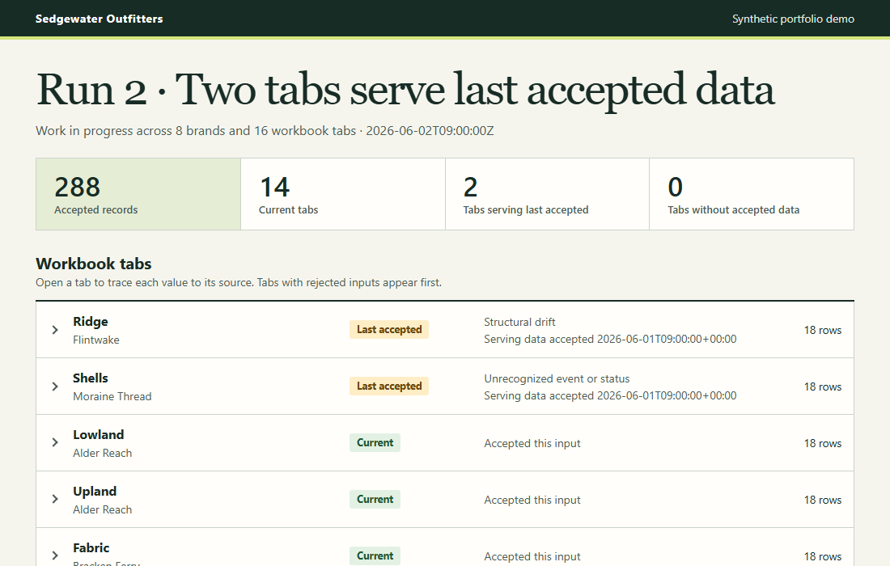
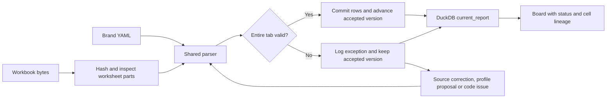

# Failsafe Workbook Pipeline

Two source tabs failed on Tuesday. The work-in-progress report still served all **288 previously validated items**, and the other 14 tabs stayed current. Readers could see which data was older and trace each value to its original Excel cell.



Sedgewater Outfitters is a fictional outdoor-gear company. Each brand tracks its own items in Excel. This independently built portfolio project demonstrates the engineering behind a reporting system that can keep running when its inputs change. All workbooks, names and scenarios are synthetic.

**Watch the [16-second walkthrough](demo/walkthrough.gif)** or explore the actual board without installing anything. Open the [saved Run 2 board](demo/snapshots/run2/board.html), choose **Download raw file**, and open the downloaded HTML in a browser.

To reproduce the results, clone this repository and run the following command from its root with [uv](https://docs.astral.sh/uv/) installed. The first run downloads the locked Python dependencies. The demo itself runs locally with no account.

```sh
uv run --locked python -m pipeline demo
```

Open **`build/demo/run2/board.html`**, then expand **Ridge**. Its candidate workbook calls the date column “Due on” at `D1`. The board shows the rejected SHA, the earlier accepted SHA, and the original cells for all 18 served records. In **Basin**, the new date at `D2` loaded from that same candidate workbook.

## Four deliveries

| Delivery | What changed | What the reader gets |
| --- | --- | --- |
| 1 · Baseline | Eight brands submit 16 tabs in eight layouts. | 288 rows in one report. Five business fields per item, each with source lineage. |
| 2 · Drift and triage | Ridge renames its header. Shells reports “Awaiting field call” at D4. | Two tabs serve dated fallback. A human-approved alias restores Ridge. Shells stays on fallback until its source team supplies a governed stage. |
| 3 · Code repair | East splits item CR-018 across an ID row and a details row. | East serves its 18 earlier rows while West refreshes. The linked repair recovers the ID at A20 and the new date at D21. [Issue](https://github.com/snicolello/failsafe-workbook-pipeline/issues/1) · [Repair PR](https://github.com/snicolello/failsafe-workbook-pipeline/pull/3) |
| 4 · Onboarding and recurrence | A ninth brand combines an offset header with vertical stage sections. The date alias recurs on Basin. | One new profile adds 36 rows. The recurring header loads automatically. All 324 rows across 18 tabs are current. |

## Where the decisions happen



**The failure boundary is a worksheet.** A tab is the unit a source team can fix and the unit a reader can identify as stale. One transaction records the attempt and advances the accepted version only when every row passes. A first-time failure serves zero rows. A broken workbook container records a failure against each known tab. [Cleanup](pipeline/cleanup.py) · [Acceptance store](pipeline/store.py) · [Fault and recovery tests](tests/test_ingest.py)

**A layout rule has an owner and a scope.** A shared parser handles banners, hierarchical headers, sections, horizontal milestones, title-derived fields and stacked tables. A profile-only preview compares actual field values and lineage across brands. Extending record identity required code, a fixture and a regression that keeps ambiguous pairs out. [Profiles](profiles/) · [Parser](pipeline/parser.py) · [Split-row regression](tests/test_paired_rows.py) · [Owner-reviewed profile changes](demo/repair-review.md)

**A model can explain a refusal and propose a repair.** The normal path is deterministic. The replay includes genuine Claude findings matched to the workbook SHA, tab, category and source excerpt. Claude's Flintwake proposal passed replay. Its Gale Stitch proposal assigned two competing sources for stage, so validation refused it before any rows were written. The owner-approved profile passed. The optional live path uses a tool-free Claude Code process with a per-call spending limit. [Shells finding](demo/reviews/moraine-thread.json) · [Profile review evidence](demo/repair-review.md) · [Review integration](pipeline/review.py)

## Inspect or change the evidence

```sh
# Process an editable workbook using a persistent local store and board.
uv run --locked python -m pipeline ingest fixtures/run1/flintwake.xlsx profiles/flintwake.yaml

# Preview a profile change with all other brands as controls.
uv run --locked python -m pipeline.preview fixtures/run2/flintwake.xlsx fixtures/repairs/flintwake.yaml

# Run the full test suite, including four-delivery replay.
uv run --locked python -m pytest -q
```

The ingest command writes `build/status.html` and `build/current.duckdb`. Edit a target date in a copy named `flintwake.xlsx` and run ingest on that copy to see its new date, SHA and cell. Repeating the same source, profile and parser version adds zero decisions. For an authorized live review, add `--claude` to ingest on a new exception. The full demo writes six snapshots, corresponding JSON records and a queryable `build/demo/report.duckdb`. Its observation times are fixed for reproducibility.

The five-field contract catches violations that a workbook can demonstrate. A plausible but incorrect date can still pass. The verified runtime is local Python and DuckDB. The optional [Databricks target](databricks/) includes the SQL and comparison procedure prepared for later workspace verification. [Field agreement](contracts/core-fields.md) · [Repository baseline](STATE.md)
